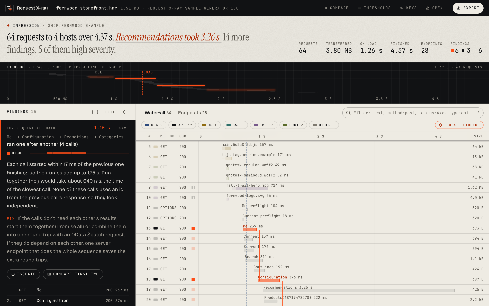
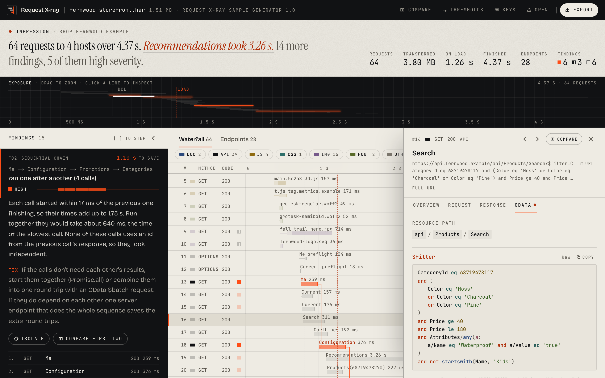

# Request X-ray

**Count the calls. Find the waste.**

Request X-ray turns a HAR file (the network log exported from browser DevTools) into a clear report of what a page did over the network, and where it wasted effort: the same endpoint hit twenty times, calls that waited on each other for no reason, uncompressed JSON, slow and failing requests. It decodes OData queries into something you can read.

Everything runs in your browser. A HAR file never leaves the tab.



## What it does

- **Impression.** A one-sentence reading of the capture, like the impression line of a radiology report: how many requests, how long, and the single thing most worth fixing.
- **Exposure strip.** Every request drawn as a line of light on a dark film. Busy moments glow, the active finding burns orange, and dragging across it zooms the waterfall.
- **Waterfall.** Every request on one time axis, colour-coded by type, with queue, server wait and download shown as parts of each bar. Sequential chains are drawn with connectors. Virtualized, so 30,000 rows scroll smoothly.
- **Endpoints.** Requests grouped by method and normalized URL (`/Products(42)` and `/Products(43)` are one endpoint), with count, total, average and max time, size, and a timeline of when each call fired. Sortable.
- **Findings,** each with a severity, a plain explanation, a fix, and links to the requests involved.
- **OData decoding.** `$filter` pretty-printed and read back in plain English, `$select`, nested `$expand`, `$orderby`, paging, and `$batch` bodies split into their parts.
- **Request diff.** Two requests side by side: summary with deltas, query parameters, headers, and a line diff of the bodies.
- **Redact and export.** An HTML report, a JSON report or a sanitized HAR, with auth headers, cookies, tokens and emails removed.



## Findings

| Code | Rule | What it looks for | Default |
| --- | --- | --- | --- |
| DUP | Duplicate calls | The same method, URL and body requested more than once | 2+ identical calls |
| N+1 | Chatty endpoint | One API endpoint called with many different ids, where one batched call would do | 5+ different ids |
| SEQ | Sequential chain | API calls that ran one after another when they could run in parallel | 3+ calls, 50 ms apart or less |
| SLOW | Slow request | Requests over the time threshold, with the phase that took longest | 1 s |
| SIZE | Large response | Responses over the size threshold | 250 kB API, 1 MB files |
| GZIP | No compression | Text responses sent without gzip or Brotli | text over 1 kB |
| CACHE | No cache headers | Static files without Cache-Control or Expires | scripts, styles, fonts, images |
| ERR | Errors | 4xx, 5xx, failed and cancelled requests | |
| $SEL | OData over-fetch | OData reads that return every field because the query has no `$select` | 15+ fields |

Thresholds are adjustable in the app and saved in the browser.

A few details that keep the findings honest:

- **Sequential chains check for real dependencies.** If a call uses an id that first appeared in the previous call's response, the link is dropped: that call had to wait. A value both calls sent (a channel id, say) doesn't count.
- **Cache hits don't count as duplicates.** They never reached the network.
- **Waves of calls to one endpoint** belong to the chatty rule, not the chain rule, so staggered tile requests don't show up as fake chains.
- **Big captures stay readable.** Many duplicated URLs on one endpoint roll up into one finding, and only the 25 costliest chains are reported.

## Privacy

- Parsing and analysis run in a Web Worker on your machine. There is no server.
- The Content Security Policy only allows requests to the page's own origin, so the browser blocks any attempt to send data elsewhere. An end-to-end test checks that loading a file makes no cross-origin requests.
- Exports strip `Authorization`, cookies, API keys, session and CSRF headers, tokens in URLs and JSON bodies, JWTs, bearer tokens, card numbers (Luhn-checked) and, by default, emails. Reports never include response bodies.
- Sensitive headers are masked in the inspector until you choose to show them, so a screen share doesn't leak a token.

## How it works

```
File ──► Web Worker ─────────────────────────────────────────────► UI
         read (streamed, with progress)
         parse (friendly errors: empty, not JSON, truncated, not a HAR)
         prepare: normalize entries, group endpoints        (once per file)
         rules: 9 findings, summary                         (again when thresholds change)
         ◄── on demand: request detail, OData decode, diff, export
```

The worker keeps the parsed HAR. The page gets a lightweight report (no bodies) and asks for bodies, diffs and exports when it needs them. A 76 MB capture with 30,000 requests is analysed in about a second, and the main thread never blocks for more than a frame or two.

All analysis lives in plain, framework-free TypeScript under `lib/`, so it is easy to test and could run in a CLI.

```
lib/
  har/        parse, normalize entries, resource types, endpoint patterns
  analysis/   rules, endpoints, summary, impression
  odata/      $filter parser (Pratt), query options, $batch
  diff/       Myers line diff, keyed diffs
  redact/     redaction
  export/     HTML report, JSON report, sanitized HAR
  worker/     message handler, request detail, request diff
components/   landing, workspace (rail, exposure, waterfall, endpoints, inspector, dialogs)
workers/      the Web Worker entry
scripts/      synthetic sample generator
e2e/          Playwright flows and accessibility audits
```

## Develop

```bash
npm install
npm run dev          # http://localhost:3000, or /?sample to open the demo
npm test             # unit tests (Vitest)
npm run test:e2e     # end-to-end and accessibility tests (Playwright, production build)
npm run lint
npm run typecheck
npm run sample       # regenerate public/samples/fernwood-storefront.har
```

The sample is synthetic: a made-up storefront on reserved `.example` domains with fake tokens, built to trigger every finding. Real HAR files contain credentials and customer data, and `.gitignore` keeps them out of the repo.

## Quality

- Unit tests cover the parser, every finding rule, OData decoding, diffing, redaction and exports. One test plants secrets in a HAR and checks that none survive any export format.
- End-to-end tests run against the production build: load a file, follow a finding, decode OData, export a redacted report and read it back.
- axe-core audits the landing page, workspace, inspector, dialogs and diff against WCAG 2.1 AA.
- Keyboard first: `[` and `]` step through findings, `j` and `k` move through requests, `/` filters, `?` lists every shortcut. Motion respects reduced-motion settings.

## Stack

Next.js (App Router, static), React, TypeScript (strict), Tailwind CSS 4, a Web Worker, Canvas for the exposure strip, Vitest, Playwright. The design follows [sujanrokad.com](https://sujanrokad.com): paper, ink and one signal colour, set in Bricolage Grotesque, Instrument Serif and JetBrains Mono.

Built by [Sujan Rokad](https://sujanrokad.com).
